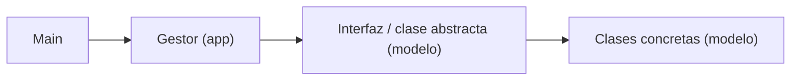

# Programación II · Práctica

Ejercicios de la materia Programación II (TUP): programación orientada a objetos en Java y tipos abstractos de datos. Cada ejercicio vive en su propio paquete bajo `src/` y tiene su propio `main` para ejecutarlo de forma independiente.

## Estructura

```
src/
├── Main.java               ejercicios de las clases 5 a 7, en un solo programa
├── CLASE_5/                clases, objetos, constructores y encapsulamiento
├── CLASE_6/                herencia, sobreescritura y polimorfismo
├── CLASE_7/                sobrecarga de métodos
├── practica/               ejercicios sueltos de POO
│   └── TAD/                playlist de música sobre LinkedList
├── ejercicio_1/            sistema de envíos (interfaces y clases abstractas)
├── ejercicio_2/            espacios de coworking
├── alquiler_vehiculos/     alquiler de vehículos con gestor de flota
└── listas_enlazadas1/      TAD lista: implementación estática y dinámica
```

## Taxonomía

- Los paquetes `CLASE_N` agrupan los ejercicios de la guía de cada clase.
- Los sistemas más grandes separan el dominio de la ejecución: `modelo` tiene las clases, interfaces y clases abstractas, y `app` tiene el gestor que las administra y el `Main` que las prueba.
- Los nombres de clases y métodos están en español, salvo los ejercicios de `practica/` hechos sobre consignas en inglés.

## Flujo de un sistema



`Main` crea los objetos concretos y se los entrega al gestor, que los guarda en una colección tipada por la interfaz o la clase abstracta. Sobre esa colección el gestor resuelve los reportes y cálculos, y cada objeto responde con su propia implementación (binding dinámico).

## TAD Lista

`listas_enlazadas1` compara dos implementaciones del mismo TAD: `ListaEstatica`, sobre un arreglo de capacidad fija, y `ListaEnlazada`, sobre nodos enlazados. El informe comparativo está en [`src/listas_enlazadas1/README.md`](src/listas_enlazadas1/README.md).

## Cómo se corre

Con IntelliJ IDEA, abriendo la carpeta del repo y ejecutando el `Main` del paquete que interese. Desde la terminal, con Java 21:

```bash
javac -encoding UTF-8 -d out $(find src -name "*.java" ! -path "src/Main.java")
java -cp out listas_enlazadas1.app.Main
```

`src/Main.java` usa un `main` sin clase contenedora, que en Java 21 es una característica en vista previa: se compila con `javac --enable-preview --release 21` y se ejecuta con `java --enable-preview`.
